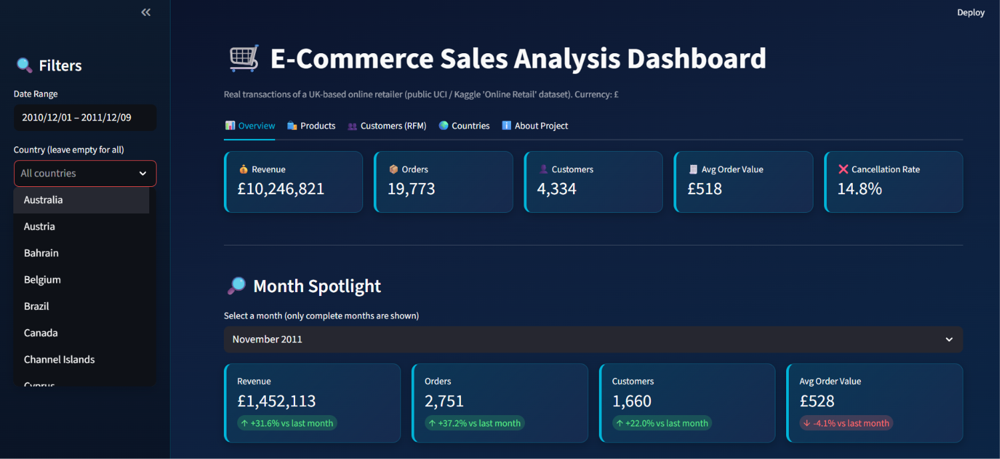

# 🛒 E-Commerce Sales Analysis Dashboard

An interactive analytics dashboard built on **5.4 lakh (541,909) real transactions** of a UK-based online gift retailer. It cleans the raw data, calculates business KPIs, segments customers with RFM analysis and answers: *what sells, where, when, and to whom, and how much revenue is lost to cancellations?*

### 🔗 [**Live Demo → e-commerce-sales-analysis-dashboard.streamlit.app**](https://e-commerce-sales-analysis-dashboard.streamlit.app/)

> The app may take a few seconds to wake up if it has been idle (free Streamlit hosting).

---

## 📸 Preview

| | |
|---|---|
|  |  |
|  |  |

---

## 📊 Key Insights

| Metric | Value |
|---|---|
| Total revenue | **£10.25M** |
| Orders / Customers | **19,773** orders from **4,334** customers |
| Average order value | **£518** |
| Cancellation rate | **14.8%** of orders (worth £4.76 lakh) |
| Peak month | **November 2011** (£1.45M), the pre-Christmas gifting rush |
| Top product | **Regency Cakestand 3 Tier** (£1.74 lakh) |
| Top country | **United Kingdom**, 85.1% of revenue |
| Busiest day | **Thursday** (4,209 orders) |
| Repeat customers | **65.3%** of identified customers ordered more than once |

---

## ✨ Features

The dashboard has 5 tabs:

- **📊 Overview**: KPI cards, *Month Spotlight* with month-over-month growth, monthly revenue trend, MoM growth chart, orders by day of week and hour of day, auto-generated key insights.
- **🛍️ Products**: top 10 products by revenue or quantity, plus a **searchable Product Explorer** (revenue, units, cancelled %, monthly trend, top countries for any product).
- **👥 Customers (RFM)**: customer segmentation into *Champions, Loyal, New Customers, Need Attention, At Risk, Lost*, with segment size, revenue share, recommended business action and CSV download.
- **🌍 Countries**: world map of revenue, top countries and a country details table (option to exclude the UK so other markets are visible).
- **ℹ️ About Project**: project explanation and the full data cleaning summary.

Sidebar filters: **date range** and **country**.

---

## 🧹 Data Cleaning

Real data is messy, so the raw file was cleaned before any analysis:

| Step | Rows |
|---|---|
| Raw rows | 541,909 |
| Duplicate rows removed | 5,268 |
| Non-product rows removed (postage, bank charges, gift vouchers) | 2,989 |
| Invalid rows removed (zero/negative price or quantity, adjustments) | 2,480 |
| Rows with missing CustomerID (kept for sales, excluded from customer metrics) | 135,037 |
| Cancellations (invoice starts with `C`) flagged separately | 8,668 |
| **Final clean rows** | **531,172** (1 Dec 2010 to 9 Dec 2011) |

Cancelled orders are kept separate from sales so revenue is not understated, and the cancellation rate is calculated on its own.

---

## 🛠️ Tech Stack

- **Python**
- **Pandas, NumPy**: data cleaning and analysis
- **Excel (.xlsx)**: raw data source, loaded with Pandas and openpyxl
- **Plotly**: interactive charts and world map
- **Streamlit**: dashboard and deployment (Streamlit Community Cloud)

---

## 📁 Project Structure

```
├── ecommerce.py                  # Streamlit app (cleaning + analysis + dashboard)
├── online_retail_clean.csv.gz    # Cleaned dataset (generated by the app)
├── cleaning_summary.json         # Cleaning statistics shown in the app
├── requirements.txt              # Python dependencies
└── README.md
```

---

## ▶️ Run Locally

```bash
git clone https://github.com/basharux/E-Commerce-Sales-Analysis-Dashboard.git
cd E-Commerce-Sales-Analysis-Dashboard
pip install -r requirements.txt
streamlit run ecommerce.py
```

On Windows, if `streamlit` is not recognised, use `python -m streamlit run ecommerce.py`.

To rebuild the cleaned file from scratch, download the raw Excel file, place it in the project folder (for example `Online_Retail.xlsx`), run `pip install openpyxl`, delete `online_retail_clean.csv.gz`, and start the app. It cleans the data on the first run.

---

## 📌 Notes and Limitations

- The data ends on **9 Dec 2011**, so December 2011 is a partial month.
- The dataset has **no Saturday transactions**.
- About **25% of rows have no CustomerID**, so customer-level metrics (customers, repeat rate, RFM) cover identified customers only.
- Many customers are wholesalers, which is why the average order value is high.

---

## 📚 Data Source

**Online Retail dataset**, UCI Machine Learning Repository (also available on Kaggle). Transactions of a UK-based online retailer between 01/12/2010 and 09/12/2011.

---

## 👤 Author

**Bashar Hayat**: B.Tech Computer Science Student | Aspiring Data Analyst
[LinkedIn](https://linkedin.com/in/basharhayat) · [GitHub](https://github.com/basharux)
